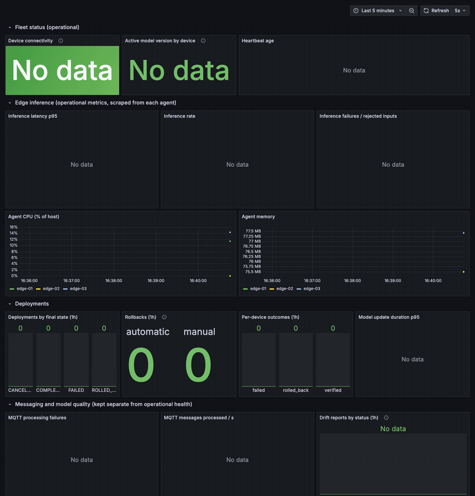
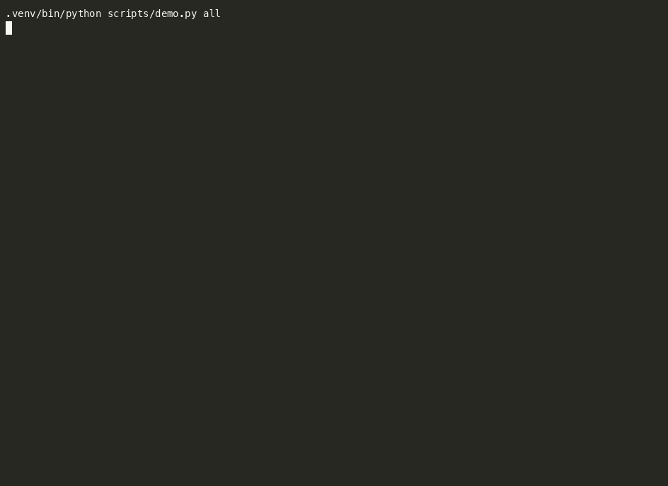
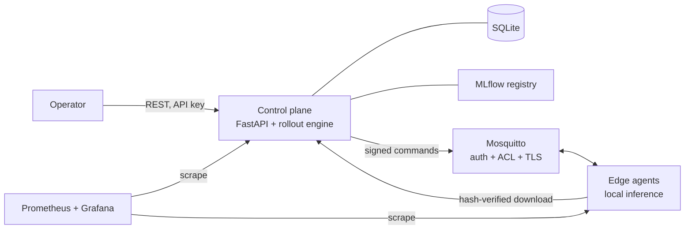

# FleetOps

Deploy, monitor and roll back ML models on a fleet of factory edge devices: canary rollouts with automatic rollback, a model quality gate and offline inference. Python, FastAPI, MQTT, MLflow, Prometheus/Grafana.

[](https://github.com/nithya-prakash/FleetOps/actions/workflows/ci.yml)


## Demo


Above: the real Grafana dashboard while `make demo` runs on the full Docker stack (screenshots every 2 s, replayed about 9x, label shows real elapsed time). It shows three devices going from no model to v1 to v2, an injected fault producing **one automatic rollback** (rollback counters, per-device outcomes, failing inference on edge-01), and traffic on the MQTT bus. The early "unregistered" MQTT failures are the agents starting before the demo registers them.



Below it: the terminal side of the same demo (a recording of one run, waits over 1.5 s shortened): canary rollout, the quality gate rejecting a worse model, a device losing its network and **still inferring locally**, then Prometheus' record. Neither shows real hardware (simulated sensors only). Full text of a run: [docs/demo-output.txt](docs/demo-output.txt); how both were recorded: [docs/demo.md](docs/demo.md).

## Results
The model is trained and benchmarked on **real recordings** from one lab hydraulic test rig ([UCI, CC BY 4.0](#data)); the devices, network and load are simulated. Numbers come from one Apple M4 laptop (Docker Desktop), not from a production environment.

| Metric | Result | Data / workload | Reproduce |
|---|---|---|---|
| Automated tests | 367 pass (94% line coverage when last measured, before the data switch) | 275 unit, 66 integration, 26 end-to-end, real Mosquitto | `make test-mqtt` (coverage: `pytest --cov`) |
| Live security checks | 52 pass | running Compose stack | `make verify-security` |
| Anomaly model v1 | precision 0.88, recall 0.82, F1 0.85, ROC-AUC 0.95, false-positive rate 0.054 | 662 held-out real rig cycles, 33% faulty (`hydraulic-benchmark-v1`); v2 on the same cycles: precision 0.81, recall 0.88, FPR 0.106 | `python scripts/demo.py gate` |
| Edge `/predict` | 1,202 req/s per agent, p99 30 ms (16 clients) | 15 s per level, 256 fixed payloads; measured 2026-10-13 with the earlier 6-feature model, not re-run on the 5-feature one | `python -m scripts.load_test.run predict` |
| Rollout to 100 devices | 12-13 s (4/4 completed; 3/3 timed out before a fix) | 100 simulated agents over real MQTT | `python -m scripts.load_test.run warmup --devices 100` |
| Soak | PASS: 50 min (42 min steady state), no memory growth | 50 simulated devices, rollout every 5 min | `python -m scripts.load_test.run soak --devices 50 --duration 3000` |
| Recovery | 5.2 s after a control-plane restart, 1.6 s after a broker restart | 50 simulated devices | `python -m scripts.load_test.run restart --devices 50` |
| Failure injection | 12 scenarios pass | broker restart, crash mid-download, corrupt artifact, ... | `pytest tests/end_to_end` |

The load-test commands need simulated-device credentials and raised rate limits first: see [docs/load-test-results.md](docs/load-test-results.md).

## Honest reading
The model is a small MLP on five sensor means from a lab rig (precision 0.88 / recall 0.82 on 662 held-out cycles); the point of the project is the rollout, rollback and monitoring machinery, not the detector. "Anomaly" means a severe pump leak or a valve near total failure, applied deliberately in the experiment, so the one-third fault rate and the scores say nothing about a production line. v2 catches more faults than v1 but raises more false alarms, which is why the demo's strict gate blocks it and the demo's relaxed policy accepts it. The throughput, soak and recovery rows above predate the switch to real data.
Performance was measured on one laptop with simulated devices; nothing ran on physical edge hardware, a native Linux host or x86_64. CI ran on GitHub for the first time on 2026-10-13: the first run had two failing jobs
(real defects, since fixed); the badge above shows the current state and [docs/ci.md](docs/ci.md) the history. The 50-minute soak is not evidence of multi-day stability.

## Quickstart
```bash
make init   # venv from uv.lock, dev-only .env, credentials (needs Docker + uv)
make up     # Mosquitto, MLflow, control plane, 3 edge agents, Prometheus, Grafana
make demo   # the full lifecycle; API docs at http://localhost:18000/docs, Grafana at :13000
```
| Variable | Purpose |
|---|---|
| `FLEETOPS_ADMIN_API_KEY` / `_OPERATOR_` / `_VIEWER_` | Bearer keys for the three API roles (dev values in `.env.example`) |
| `FLEETOPS_DEVICE_KEY_MASTER` | derives each device's credential |
| `FLEETOPS_BIND` | interface for published ports (default `127.0.0.1`) |
| `FLEETOPS_ENV` | `prod` refuses to start without TLS and strong keys |

## Architecture

Python 3.12, FastAPI, SQLAlchemy/Alembic (SQLite), MLflow, Mosquitto/paho-mqtt, PyTorch (training only), NumPy + safetensors (edge runtime), Docker Compose, k3s manifests, GitHub Actions.

## Usage
```bash
# after `make demo` (it registers edge-01..03 and the models)
KEY=$(grep FLEETOPS_OPERATOR_API_KEY .env | cut -d= -f2)
curl -s -X POST localhost:18000/api/v1/models/train -H "Authorization: Bearer $KEY" -H 'Content-Type: application/json' \
  -d '{"model_name":"anomaly-detector","params":{"epochs":10}}'            # train + register a version
curl -s -X POST localhost:18000/api/v1/deployments -H "Authorization: Bearer $KEY" -H 'Content-Type: application/json' \
  -d '{"model_name":"anomaly-detector","model_version":1,"group":"line-a","strategy":{"canary_count":1,"batch_percent":50}}'
```
Endpoints: `GET /api/v1/devices`, `GET /api/v1/deployments/{id}`, `POST /api/v1/deployments/{id}/rollback`, edge `POST :19101/predict`. Full reference: [docs/api.md](docs/api.md).

## Data
Training, the fixed benchmark and the edge replay use the UCI *Condition monitoring of hydraulic systems* dataset: Helwig, Pignanelli and Schütze (ZeMA gGmbH / Saarland University), [doi:10.24432/C5CW21](https://doi.org/10.24432/C5CW21), licence CC BY 4.0. 2,205 cycles of 60 s were recorded on a test rig while cooler, valve, pump and accumulator were set to known conditions. `src/fleetops/training/resources/hydraulic_cycles.csv` is a derived file (cycle means of five physical sensors plus the condition labels; `scripts/prepare_hydraulic_data.py` rebuilds it and checks the original's SHA-256). Anomaly = severe pump leak or valve near total failure. A stratified 30% of cycles (662) is held out as the benchmark and never trained on. Edge agents replay their own seeded shuffle of the recorded cycles; the `drift` scenario replays only cycles recorded while the cooler was close to total failure, a real change of operating regime that moves every sensor (all five features alert). A small synthetic generator remains in `tests/synthetic_sensors.py` only as a fast fixture for the drift-statistics unit tests.

## Limitations
- Single control-plane replica on SQLite: **not highly available**; no PostgreSQL or leader election (design in [docs/capacity-and-scaling.md](docs/capacity-and-scaling.md)).
- Development CA only; no production PKI, no Alertmanager or paging, no external security review ([docs/security-assessment.md](docs/security-assessment.md)).
- Not run on physical devices, native Linux or x86_64 at runtime (amd64 image built and smoke-tested under emulation); the Raspberry Pi guide is unverified.
- Real data from one lab rig only (no fleet data); one MLP model format; the quality gate uses a 662-cycle benchmark from that rig. The Grafana GIF above was recorded before the data switch (it shows rollout state, not model metrics).
- Backup script exists but no restore drill has been done. Not claimed production-ready.

## Repository
`src/fleetops/` code - `tests/` - `scripts/` demos, load tests, benchmarks - `deploy/` + `compose*.yaml` - `monitoring/` - `docs/` ([details.md](docs/details.md) has the full reference, runbooks and engineering notes).
Checks: `make lint && make test-mqtt`. License: [MIT](LICENSE).
