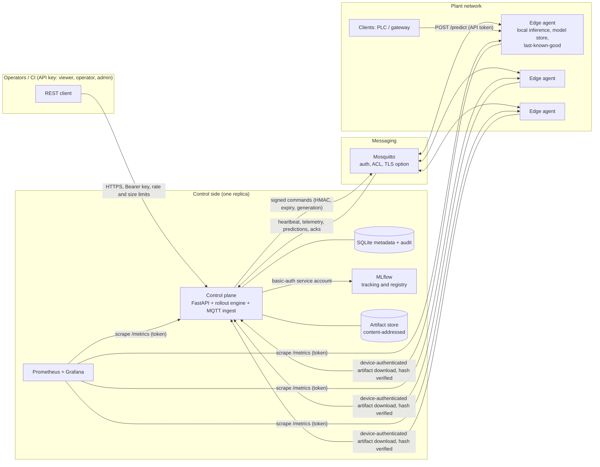

# FleetOps architecture

FleetOps answers one question: *how can a team deploy and maintain AI models on many factory
devices without hand-managing each one?* This document records the design, the decisions behind
it, the threat/risk model and the phased plan. It is kept in sync with the code; section
"Deviations from the brief" lists where the implementation intentionally differs.

## 1. System context

```
                       ┌──────────────────────── cloud / control side ─────────────────────────┐
 operator ──HTTPS/API──►  Control plane (FastAPI)                                               │
 (API key, role)       │   ├─ REST /api/v1  (devices, models, deployments, drift, audit)        │
                       │   ├─ Model distribution (device-authenticated artifact download)       │
                       │   ├─ Rollout engine (state machine, persisted)                         │
                       │   ├─ MQTT ingest (heartbeat/telemetry/predictions/status)              │
                       │   ├─ Drift monitor                                                     │
                       │   └─ /metrics (Prometheus)                                             │
                       │        │ SQL (SQLite→PostgreSQL)        │ MLflow client                │
                       │   ┌────▼─────┐                    ┌─────▼──────┐     ┌──────────────┐  │
                       │   │ Metadata │                    │ MLflow     │     │ Artifact     │  │
                       │   │ DB       │                    │ tracking + │     │ store (disk  │  │
                       │   └──────────┘                    │ registry   │     │ volume)      │  │
                       │                                   └────────────┘     └──────────────┘  │
                       └───────────────▲──────────────────────────────────────────────────────┘
                                       │ MQTT (Mosquitto, per-device credentials + ACL)
              ┌────────────────────────┼─────────────────────────┐
              │                        │                         │
        ┌─────▼──────┐          ┌──────▼─────┐           ┌───────▼────┐
        │ edge-01    │          │ edge-02    │           │ edge-03    │   (factory side)
        │ agent      │          │ agent      │           │ agent      │
        │  model store (atomic, last-known-good)   local inference  │
        └────────────┘          └────────────┘           └────────────┘
 Prometheus scrapes control plane + every agent; Grafana renders the provisioned dashboard.
```

### Component responsibilities

| Component | Package | Responsibility |
|---|---|---|
| Control plane | `fleetops.controlplane` | REST API, auth, device inventory, MQTT ingest, background loops |
| Rollout engine | `fleetops.deployment` | Planning, state machine, canary/batch promotion, health evaluation, rollback, retries |
| Registry | `fleetops.registry` | Model bundle format, content-addressed artifact store, MLflow tracking/registration |
| Training | `fleetops.training` | Synthetic dataset, PyTorch training, evaluation, export to a safe bundle |
| Messaging | `fleetops.messaging` | Topic convention, message schemas, bus abstraction (MQTT + in-memory for tests) |
| Edge agent | `fleetops.edge` | Local inference, model store, command handling, heartbeat/telemetry, fault injection |
| Monitoring | `fleetops.monitoring` | Prometheus metrics, drift statistics |
| Security | `fleetops.security` | API-key roles, per-device identity, command signing, checksums |
| Persistence | `fleetops.persistence` | SQLAlchemy models, repositories, Alembic migrations |
| Domain | `fleetops.domain` | Pure types and logic (state machine, health evaluation, manifests) — no I/O |

Dependency direction: `domain` ← `security`/`messaging schemas` ← `persistence`/`registry` ←
`deployment` ← `controlplane`. `domain` and the rollout *decision* logic never import FastAPI,
paho or SQLAlchemy sessions directly; the engine receives a `CommandPublisher` and a session
factory.

### Component diagram (as implemented, with trust boundaries)



The same diagram with the unimplemented high-availability target is in `docs/capacity-and-scaling.md`. Reliability behaviour of each arrow under failure is
documented in `docs/reliability-test-results.md`; operational response in `docs/runbooks/`.

## 2. Data boundaries

| Data | Where | Why |
|---|---|---|
| Device metadata, deployments, targets, audit, drift reports, review recommendations, feature samples | Relational DB (SQLite, SQLAlchemy; PostgreSQL-compatible types only) | Transactional, restart-safe orchestration state |
| Experiments, runs, metrics, registered models + versions | MLflow (tracking server, sqlite backend in compose) | System of record for model lineage |
| Model artifact bytes | Content-addressed filesystem store (`<root>/<name>/<version>/model.safetensors`) | Kept apart from metadata; swappable for S3/MinIO behind `ArtifactStore` |
| Operational time series (latency, counts, CPU, heartbeat age) | Prometheus | Telemetry is *not* stored relationally; only the latest heartbeat snapshot per device is |
| Drift reports | Relational DB (`drift_reports`) | Auditable, queryable via API |
| Immutable model facts used by deployments (sha256, schema, compat) | `model_versions` table, written once by the registration pipeline *after* MLflow succeeded | A deployment manifest must never depend on a mutable external lookup |

## 3. Model format and security implication

Artifacts are a single **safetensors** file holding the MLP weights, standardisation statistics,
and a JSON metadata block in the safetensors header (feature names, input ranges, threshold,
architecture). The edge agent evaluates the network with NumPy — **no `pickle`, no
`torch.load`, no code in the artifact**. A malicious or corrupted file can at worst fail to
parse or produce wrong numbers; it cannot execute code. Integrity (SHA-256 against the
manifest) is verified before staging *and* again at every load (startup, activation, rollback).
Manifests carried inside commands are HMAC-signed with the device's key. TorchScript was
rejected because loading it executes a graph on the full PyTorch runtime (large attack surface,
~1 GB edge image). Trade-off: the safetensors path supports only the `mlp-v1` architecture; adding
conv nets for image defect detection means a new `format` value (the compatibility check in the
manifest exists for that).

## 4. Messaging

Topics (`fleetops/devices/{device_id}/…`):

| Topic | Direction | QoS | Retained | Content |
|---|---|---|---|---|
| `heartbeat` | device → cp | 0 | no | liveness, active/staged/previous model, per-model inference stats, CPU/mem |
| `telemetry` | device → cp | 0 | no | rates, rejected inputs, sensor summary |
| `predictions` | device → cp | 1 | no | batches of scored samples (+features for drift, optional labels) |
| `status` | device → cp | 1 | yes (LWT: `offline`) | online/offline + command acknowledgements |
| `commands` | cp → device | 1 | no | signed DEPLOY / ACTIVATE / ROLLBACK / ABORT / SET_FAULTS |

MQTT is treated as unreliable:
* **Commands** carry `command_id` (dedup), per-device monotonically increasing `generation`
  (a device ignores any command with `generation` lower than the highest it has applied →
  stale/superseded commands cannot activate an older model), and `expires_at`.
* Devices use a persistent session (`clean_session=false`, fixed client id), so queued commands
  survive disconnects; expired/stale ones are discarded on arrival.
* **Delivery is never proof of success.** A target becomes `ACTIVE` only on a device
  acknowledgement, and is promoted only after health observations (heartbeat counters reported by
  the device) satisfy the criteria. Lost commands/acks are healed by timeout-driven re-send (same
  `command_id`, bounded attempts, exponential backoff) and by *reconciliation*: whenever a device
  reports `online` or a heartbeat that disagrees with its desired state, the engine re-issues the
  outstanding command.
* Messages are size-limited (broker `message_size_limit` and pydantic caps), validated, and a
  validation failure increments `fleetops_mqtt_processing_failures_total` instead of crashing the
  handler.

## 5. Deployment state machine

Per-device **target** states: `PENDING → DISTRIBUTING → STAGED → ACTIVE` plus `FAILED`,
`ROLLED_BACK`, `CANCELLED`.

```
PENDING ──DEPLOY sent──► DISTRIBUTING ──device: download+sha256+load+smoke test ok──► STAGED
STAGED ──ACTIVATE sent, device ack ACTIVE──► ACTIVE ──health criteria met──► (verified)
any non-terminal ──ack failed / timeouts exhausted / health failed──► FAILED
ACTIVE|STAGED|DISTRIBUTING|FAILED ──ROLLBACK/ABORT acked──► ROLLED_BACK
PENDING ──cancel / rollback / supersede──► CANCELLED
```

**Deployment** states: `PENDING → IN_PROGRESS → COMPLETED`, with `ROLLING_BACK → ROLLED_BACK`,
`FAILED` (halted and nothing more to revert, or rollback impossible) and `CANCELLED`.

Rollout: eligible devices (registered, not revoked, online, in group, compatible, not part of a
conflicting in-flight deployment) are ordered deterministically and split into batches (first
batch = canary; explicit sizes or percentages). A batch is complete when all its targets are
`ACTIVE` **and** verified by the health evaluator. A failure (ack failure, ack/health timeout,
health criteria breach) halts promotion and moves the deployment to `ROLLING_BACK`; every target
that may be running or may later run the new model gets a `ROLLBACK`/`ABORT`, untouched targets are
`CANCELLED`, and the deployment becomes `ROLLED_BACK` only when devices have acknowledged.
Rollback is a real model switch: the agent re-verifies and loads the previous model from its local
store and atomically repoints its active pointer; a persisted state file survives restarts.
All state is in the DB; the engine is a stateless function over DB rows run by a ticker and by
device events, so a control-plane restart resumes in-flight rollouts.

Creation is idempotent (`Idempotency-Key`). A new deployment for the same model+group supersedes
an in-flight one (older one is `CANCELLED`, reason `superseded`); overlap with a different
in-flight deployment is `409`.

## 6. Edge agent

* `ModelStore`: `models/<name>/<version>/model.safetensors`, `staging/` for partial downloads,
  `state.json` (active/previous/staged pointers, highest generation applied, recent command ids)
  written with write-temp → fsync → `os.replace`. Active and previous are retained; others GC'd.
* Activation = verify checksum → load → smoke test → swap in-memory model under lock → atomically
  persist pointer. A failure at any step leaves the old model serving.
* Startup: load active; on corruption fall back to previous; if none, report `NO_MODEL` (inference
  returns 503) — never a silent wrong answer.
* Inference never touches the network. A simulated sensor stream and `POST /predict` both use the
  in-process model. Outage = MQTT/HTTP unavailable; inference continues, heartbeats resume with
  reconnect.
* Deterministic fault injection (`FaultConfig`): corrupt download, fail activation, fail inference,
  added latency — keyed by model version, set by signed `SET_FAULTS` command (only if the
  control plane has `FLEETOPS_SIMULATION_ENABLED=true`, and the agent has `…_ALLOW_FAULTS=true`) or env.

## 7. Drift and quality

Reference per-feature quantile bins + proportions are computed from the training set and stored
with the model version. The monitor buckets recent edge feature samples into the reference bins and
computes **PSI** and a **chi-square goodness-of-fit** p-value per feature. Status per feature is
`OK/WARN/ALERT` from configurable thresholds (default PSI 0.1/0.25, with minimum sample count).
An `ALERT` creates a *review recommendation* (human workflow: acknowledge / dismiss); nothing is
promoted automatically, and drift ≠ inaccuracy: if labelled predictions exist, precision/recall are
reported separately in the same report; otherwise the report states that quality is unmeasured.
Operational metrics (latency, errors) are kept strictly apart from model-quality metrics.

## 8. Security model and risks

| Risk | Mitigation |
|---|---|
| Unauthorised management | Bearer API keys → roles `viewer`/`operator`/`admin`; constant-time compare; keys only from env, ≥24 chars enforced outside dev |
| Worse model rolled out because its container is healthy | Optional/mandatory **quality gate** on `POST /deployments`: thresholds + no-regression versus the incumbent(s) on a fixed benchmark, comparability checks, fail-safe on missing data, audited admin-only override (see api.md) |
| Rogue/impersonated device | Per-device key derived by HMAC-KDF from a master secret + device id + epoch; used as MQTT password (ACL: a device may only write its own topics, read its own commands) and artifact bearer; revocation by status/epoch |
| Forged commands | Control-plane-only write ACL on `commands` **and** HMAC-SHA256 signature verified by agent |
| Malicious artifact | safetensors only, size limits, sha256 from signed manifest, re-verified on load |
| Artifact exfiltration / path traversal | Device may only download versions referenced by its own non-terminal targets; API never exposes paths; name/version validated by regex; agent only downloads from its configured control-plane base URL |
| Stale/duplicate/replayed commands | command_id dedup, generation fence, expiry |
| Lost acks / partial rollout | Timeouts, bounded retries with backoff, reconciliation on reconnect, rollback retried until acknowledged |
| Unavailable dependencies | MLflow failure → training/registration returns 502 with nothing half-registered; broker loss → MQTT client reconnects with backoff, API still serves; agent keeps inferring |
| Resource abuse | Payload caps, bounded training parameters, bounded `feature_samples` retention |
| Secrets in repo / process env | Credentials mounted as secret files (`/run/secrets`), read via pydantic `secrets_dir`; gitignored `deploy/secrets` (0700); MLflow behind basic-auth with a non-admin service account; published ports bind to loopback by default; see security.md |

Residual risks (documented, not solved): single control-plane replica (SQLite + in-process
locks), plaintext MQTT/HTTP in the local profile (TLS config is provided but not exercised), no
model signing beyond checksum+HMAC manifests, simulated data only.

## 8a. Model quality gate

Training evaluates every model on a fixed benchmark (seed independent of the training seed, so any two models share the same dataset
fingerprint) and stores `bench_*` metrics plus evaluation metadata with the version. Deployment creation applies the optional policy
(`domain/quality.py`, pure and exhaustively unit-tested) **before** the manifest is built; a rejected request creates nothing and sends no
command. Metric directions are explicit (higher-is-better vs lower-is-better) and incomparable or missing evidence fails safely. This is
independent of, and in addition to, the runtime health criteria, canary and rollback.

## 9. Deviations from the brief

* **No separate `apps/` tree or standalone model-service process.** Entry points are
  `python -m fleetops.controlplane` and `python -m fleetops.edge`; model distribution is a router of
  the control plane with its own device-level authorisation. One fewer network hop and secret.
* **Edge runs NumPy, not PyTorch.** Training uses PyTorch; the exported safetensors bundle is
  executed by NumPy code verified numerically equal to the torch model. Keeps edge images small and
  avoids pickle/TorchScript execution.
* **Drift: own PSI/chi-square implementation instead of Evidently**, for transparency, a tiny
  dependency footprint and unit-testable maths.
* **MLflow client = `mlflow-skinny`** in the control plane; the tracking server image uses full
  `mlflow`.
* **In-memory message bus** is used for fast deterministic integration/E2E tests of the real agent
  and control-plane code; the MQTT implementation is tested against a real Mosquitto
  (integration test, plus the Docker Compose demo).
* **Alembic** manages the schema; SQLite is the default backend, nothing in the code is
  SQLite-specific beyond connection pragmas.

## 10. Phased plan and acceptance criteria

| Phase | Deliverable | Acceptance |
|---|---|---|
| 1 | This document, `CONTRIBUTING.md`, plan | Written |
| 2 | Foundation: settings, logging, domain, persistence + migrations, tooling | ruff/mypy/pytest green; state-machine & settings unit tests |
| 3 | ML pipeline: dataset, training, bundle format, MLflow registration | numpy == torch outputs; model registered in MLflow with checksum/schema/metrics |
| 4 | Edge agent: store, inference, MQTT, heartbeat, faults | offline inference test; atomic activation; restart recovery |
| 5 | Control plane: API, auth, ingest, audit, metrics | API tests incl. authz, pagination, idempotency |
| 6 | Rollout: manifests, distribution, canary, health, rollback, recovery | E2E: deploy A, canary B fails, rollback to A verified; restart recovery |
| 7 | Observability: Prometheus, Grafana, drift | drift unit tests; dashboard provisioned |
| 8 | Packaging: Docker, Compose, CI, K3s | `compose config`, image builds, live demo |
| 9 | Full verification | Everything above executed; failures fixed |
| 10 | README, runbooks, status report | Docs match verified behaviour |
