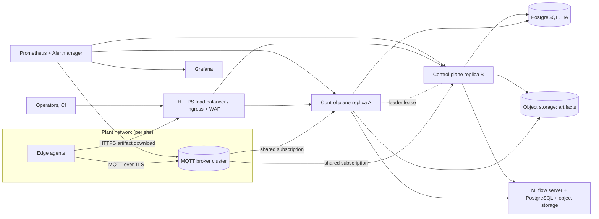

# Architecture and capacity review

Scope: what the **current** system can carry, where it stops, and what a larger design would look like. The target design in section 4 is **not implemented**
and was not tested; no new infrastructure was added in this round.

## 1. Current design in one paragraph
One control-plane process (FastAPI, in-process rollout engine and MQTT client, SQLAlchemy over SQLite, local artifact store, MLflow via SQLite) plus
one Mosquitto broker and N edge agents. The rollout engine holds per-deployment locks **in process** and drives devices via signed MQTT commands.
It is deliberately a **single replica**: this is not a highly available system, and nothing in the repository claims otherwise.

## 2. Measured capacity (laptop, Docker; see `docs/load-test-results.md`)
| Dimension | Measured | Limiting factor |
|---|---|---|
| Edge `/predict` | ~1.2k req/s per agent (1 core), p99 30 ms at 16 clients | single-worker HTTP handling, not the model (0.05 ms) |
| Management API (read mix) | 230-310 req/s, CPU-bound >150% | synchronous SQLAlchemy/SQLite in a threadpool, Python overhead |
| MQTT ingestion | 100 devices at 2 s heartbeat (51 msg/s) used ~12% CPU; lag p99 26 ms | control-plane CPU; broker negligible |
| Rollout of 100 devices | ~8 s after warm-up (canary window 2 s) | fixed health windows, not fleet size, at this scale |
| Restart recovery | control plane 5.2 s, broker 1.6 s to a fully fresh fleet of 50 | startup time, reconnect backoff |
| Memory | control plane ~0.5 GB, agent ~65 MB, broker ~3 MB | pandas/scipy/MLflow imports in the control plane |

Extrapolations (not measured): heartbeat load grows linearly with devices / interval, so 1000 devices at a 5 s interval is ~200 msg/s, about 4x the measured
rate; the single process is likely to need tuning (longer heartbeat interval, batching DB writes) before ~1k devices. Above that is unexplored.

## 3. Single replica, SQLite vs PostgreSQL
* **SQLite is the right choice today**: zero operations, transactional, and the measured workload (tens of writes/s) is well inside what it handles. Its limits are one writer at a time and one host: it cannot be shared by two control-plane replicas, and backups need a consistent copy (`sqlite3 .backup`), not a file copy of a live database.
* **Move to PostgreSQL when**: more than one replica is wanted, the database must survive the host, or writes contend (fleet of thousands). SQLAlchemy and Alembic make the schema portable, but nothing has been run against PostgreSQL; migrations 0001/0002 would need testing there (types, `ON CONFLICT`/upsert and locking behaviour differ).
* **What blocks multiple replicas besides the database**: (1) engine locks are in-process, so two replicas could drive the same deployment (needs leader election or row-level `SELECT ... FOR UPDATE`/advisory locks), (2) each replica would subscribe to the same MQTT topics (needs shared subscriptions or a single consumer), (3) the artifact store and MLflow store are local volumes (need object storage and a database-backed MLflow), (4) rate-limit and brute-force buckets are per process.
* **Failure mode today**: control plane down = no rollouts, no new inventory, no alerts from it; edge devices keep serving; on restart state resumes from the database (tested, scenario 2). Data loss window = whatever was not committed to SQLite; durability depends on the volume.

## 4. Target architecture (NOT IMPLEMENTED — design sketch)

Required changes, in order of effort: PostgreSQL support and migration tests; object-storage artifact backend behind the existing `artifact_store` interface;
a leader lease (database row with expiry) so only one replica runs the rollout engine while any replica serves reads; MQTT shared subscriptions or an ingest
queue; MLflow on PostgreSQL; shared rate-limit state (or ingress-level limiting); Alertmanager. Each of these is a separate piece of work with its own failure modes; the
current tests (in-memory harness + real broker) would need a PostgreSQL and a multi-replica variant before anyone could claim failover behaviour.

## 5. Recommendations (from the measurements, not aspirations)
1. Keep a single replica until a requirement for availability, or a fleet beyond a few hundred devices, exists; document the manual recovery (restart, resumes from DB).
2. Run a multi-hour soak on the target host before relying on long-running memory behaviour (the 10-minute soak was inconclusive: 314 -> 336 MB).
3. Before growing the fleet, raise the heartbeat interval and watch `fleetops_mqtt_ingest_lag_seconds` and control-plane CPU.
4. Measure the edge on the intended hardware (`docs/edge-devices.md`) — nothing here was measured on real edge devices.
5. Treat the rate-limit defaults (50 rps, burst 100 per client) as protections; they are far below measured capacity and correct for an operator console, wrong for automation that polls aggressively.
