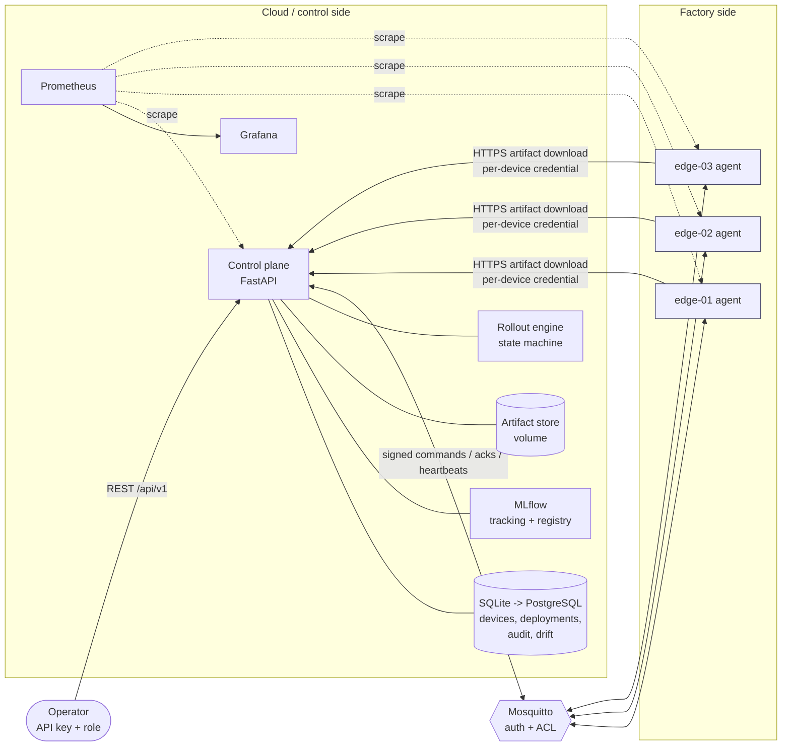

# FleetOps - detailed documentation

The full reference that used to be the README (the short README is in the repository root). Paths below are relative to `docs/`.

FleetOps answers one question: **how can an engineering team deploy and maintain AI models on many
factory devices without hand-managing each one?**

It is a working, locally runnable platform: models are trained and versioned centrally (PyTorch +
MLflow), distributed to edge agents over an authenticated channel, activated through a staged
canary rollout with health checks, and **automatically rolled back** (a real model switch on the
device) when the canary misbehaves. Devices keep inferring locally when the network or control
plane is down.

> **Scope note.** Everything runs on a laptop with simulated devices and a **synthetic** sensor
> dataset. Metrics from synthetic data say nothing about real factory performance, and the local
> profile is a development setup (plaintext MQTT/HTTP, throw-away credentials), not a production one.

## Architecture



More detail (data boundaries, state machine, message semantics, threat model, deviations from the
brief): [docs/architecture.md](architecture.md).

| Component | Where | Responsibility |
|---|---|---|
| Control plane | `src/fleetops/controlplane` | REST API, auth, inventory, MQTT ingest, background ticker |
| Rollout engine | `src/fleetops/deployment` | Canary/batch rollout, health gates, rollback, retries, crash-safe state |
| Registry | `src/fleetops/registry` | safetensors bundle format, artifact store, MLflow registration |
| Training | `src/fleetops/training` | Synthetic sensor data (Pandera-validated), PyTorch MLP, evaluation |
| Edge agent | `src/fleetops/edge` | Local inference, atomic model store, signed-command handling, fault injection |
| Monitoring | `src/fleetops/monitoring` | Prometheus metrics, PSI + chi-square drift, review recommendations |

## Tech stack and trade-offs

Python 3.12 · PyTorch · FastAPI/Pydantic · SQLAlchemy 2 + Alembic (SQLite, PostgreSQL-compatible
types) · MLflow · paho-mqtt + Eclipse Mosquitto · Docker/Compose · Prometheus/Grafana · pytest, Ruff,
mypy (strict) · GitHub Actions · optional K3s manifests.

Deliberate choices:
- **Edge runs NumPy, not PyTorch.** Training uses PyTorch; the exported **safetensors** bundle is
  evaluated by NumPy code that is tested to match the torch model. No pickle/`torch.load` on devices,
  small edge image. Limitation: only the `mlp-v1` architecture (new formats extend the manifest's
  compatibility check; image models would add one).
- **Model distribution is a control-plane router**, not a separate service (one less secret and hop).
- **Own PSI/chi-square drift code instead of Evidently**: transparent, tested, tiny.
- **Quality gate before rollout**, not just runtime health: candidates are compared with the incumbent on a fixed benchmark and blocked on regressions or missing/incomparable evidence.
- **One control-plane replica**: SQLite and in-process rollout locks. Move to PostgreSQL + leader
  election before scaling out.
- **In-memory test bus** reproduces MQTT semantics (retained, LWT, persistent sessions) so the real
  agent and control plane run deterministically in tests; the paho implementation is separately tested
  against real Mosquitto and in the Compose demo.

## Prerequisites

Docker Desktop (Compose v2), [uv](https://github.com/astral-sh/uv), Python 3.12, `make`. Optional: `k3d` + `kubectl` for the Kubernetes check.
Host ports (all bound to `127.0.0.1` by default; override in `.env`/shell): control plane **18000**, MLflow **15000**, MQTT **11883**,
Prometheus **19090**, Grafana **13000**, agents **19101-19103**.

## Quick start

```bash
make init            # uv sync from uv.lock, .env from .env.example (dev-only values), credentials -> deploy/secrets
make up              # build + start: Mosquitto, MLflow (basic-auth), control plane, 3 edge agents, Prometheus, Grafana
make bootstrap       # train + register model v1 and v2, register edge-01..03, wait until online
make demo            # deploy v1 -> canary failure & rollback -> quality gate -> healthy v2 -> offline demo
make verify-security # assert loopback binding, MLflow auth, secrets handling, container hardening on the running stack
```

Steps individually: `make deploy-v1`, `make failure-demo`, `make gate-demo`, `make promote-v2`, `make offline-demo`, `make status`.
Tear down with `make down` (keep data) or `make reset` (delete volumes).

URLs: API docs <http://localhost:18000/docs> - MLflow <http://localhost:15000> (user `admin`, password `FLEETOPS_MLFLOW_ADMIN_PASSWORD`
from `.env`) - Prometheus <http://localhost:19090> - Grafana <http://localhost:13000> (user `admin`, password `GRAFANA_ADMIN_PASSWORD`;
dashboard **FleetOps overview**).

### Configuration and secrets

Settings come from environment variables (validated by Pydantic at startup; see [.env.example](../.env.example)). **Credentials are mounted as
secret files** (`/run/secrets/*`), not passed as environment variables to containers; `python scripts/provision.py` generates them from `.env`
into `deploy/secrets/` (gitignored, mode 0700). Key rules: the three API keys must differ; in `FLEETOPS_ENV=prod` keys must be >= 24 chars,
may not contain `change-me`, simulation must be off, and MLflow + MQTT credentials are required. Per-device credentials are derived
(HMAC-KDF) from `FLEETOPS_DEVICE_KEY_MASTER`. Details: [docs/security.md](security.md).

## Using the API

Roles: `viewer` (read) < `operator` (train, deploy, cancel, rollback) < `admin` (register/revoke devices, simulation, quality override).
Full reference: [docs/api.md](api.md).

```bash
KEY=$(grep ^FLEETOPS_OPERATOR_API_KEY .env | cut -d= -f2)
curl -s -H "Authorization: Bearer $KEY" localhost:18000/api/v1/devices | jq '.items[] | {device_id,status}'

# train + register a model version (recorded in MLflow with checksum, schema, metrics and benchmark evaluation)
curl -s -X POST -H "Authorization: Bearer $KEY" -H 'Content-Type: application/json' \
  localhost:18000/api/v1/models/train -d '{"model_name":"anomaly-detector","params":{"seed":3}}'

# canary rollout under a quality policy; Idempotency-Key makes retries safe
curl -s -X POST -H "Authorization: Bearer $KEY" -H 'Content-Type: application/json' \
  -H 'Idempotency-Key: rollout-2026-10-12-a' localhost:18000/api/v1/deployments -d '{
    "model_name":"anomaly-detector","model_version":2,"group":"line-a",
    "strategy":{"canary_count":1,"batch_percent":50},
    "health_criteria":{"observation_seconds":10,"min_inferences":20,"max_error_rate":0.05},
    "quality_gate":{"metrics":{"bench_f1":{"max_regression":0.02},"bench_recall":{"max_regression":0.05}}}}'
```

## Deployment workflow

`PENDING -> DISTRIBUTING -> STAGED -> ACTIVE` per device (plus `FAILED`, `ROLLED_BACK`, `CANCELLED`).

0. **Quality gate (optional, can be mandatory):** the candidate is compared with the thresholds and with the model(s) the targeted devices run today. A regression, a missing metric, or evaluations that are not comparable gets `422 quality_gate_failed` with the exact reason; nothing is created and no device is contacted. Only an admin can override, with a reason, and the override is audited.
1. Eligible devices (registered, online, compatible, in group, not busy) are split into batches; the first is the canary.
2. `DEPLOY`: the agent downloads from its control plane only (bounded, jittered retries), verifies **sha256**, loads the bundle and smoke-tests it, then reports `STAGED`.
3. `ACTIVATE`: re-verify, atomically repoint the active model (old one kept as last-known-good), report `ACTIVE`.
4. The device reports inference counts/errors/latency/CPU/memory in heartbeats; the engine evaluates the **health criteria**. Only a passing batch promotes the next one.
5. Any ack failure, timeout or failed criterion halts the rollout and rolls affected devices back to their previous model; untouched devices are cancelled. If the rollback itself fails the deployment ends `FAILED` (needs an operator; see the rollback runbook).

Commands are signed (HMAC), deduplicated by id, fenced by a per-device generation (stale/superseded commands cannot activate an older
model) and expire; clock skew and expiry rejections are logged with the numbers needed to diagnose them. **MQTT delivery is never treated as
success**: state changes need a device acknowledgement or device-reported state, and lost acks are healed from heartbeats.

## Rollback demonstration

```bash
make failure-demo
```
Injects a deterministic fault (`fail_inference_versions=[2]`) on the canary through the admin-only simulation endpoint and deploys v2:

```
ROLLED_BACK  edge-01=ROLLED_BACK edge-02=CANCELLED edge-03=CANCELLED
final state: ROLLED_BACK - edge-01: health check failed: inference error rate 100.0% > 5.0%
edge-01: active=anomaly-detector:1 predict={'score': ..., 'model': {'name': 'anomaly-detector', 'version': 1}}
```
Follow-up lines show v1 genuinely loaded and predicting on all three agents, plus the persisted audit trail. A rollback that itself fails
(`fail_rollback` fault) ends the deployment `FAILED`, leaves the device on the bad model, and is recoverable with a second rollback request;
this is covered by an end-to-end test.

## Quality gate demonstration

```bash
make gate-demo
```
With real models v1 and v2 (v2 has slightly lower F1 but a 12-point recall drop), a strict policy is rejected before any device is touched:
```
HTTP 422 quality_gate_failed
  - [REGRESSION] bench_recall regressed: 0.5566 vs v1 0.6787 (allowed drop 0.0200, limit 0.6587)
```
A deliberately weak v3 is rejected too, an operator's override attempt gets `403`, and all devices stay on v1. `make promote-v2` then rolls
v2 out under an explicit policy that accepts the recall trade-off. See [docs/api.md](api.md#quality-gate-optional-per-deployment-can-be-made-mandatory)
and [docs/runbooks/quality-gate.md](runbooks/quality-gate.md). The benchmark is synthetic.

## Offline inference demonstration

```bash
make offline-demo
```
Cuts `edge-02`'s MQTT and control-plane HTTP (deterministic, via the agent's authenticated admin endpoint), keeps calling `POST /predict` (served
by the local model, never the cloud), shows the control plane marking it offline, then restores the link and shows state reconciled.
Buffered results are flushed on reconnect. If a model *download* is interrupted, the retry budget (`FLEETOPS_EDGE_DOWNLOAD_*`) is bounded and
the last known-good model keeps serving.

## Monitoring and drift

- **Operational metrics** (Prometheus; dashboard provisioned from `monitoring/grafana`): inference latency histogram, request/failure counts,
  model version per device, heartbeat age, connectivity, CPU/memory, clock skew, deployments by outcome, rollbacks, MQTT processing failures,
  model-update duration. Alerts: `monitoring/prometheus/alerts.yml` (offline, stale heartbeat, rollback, inference failures, latency, MQTT
  failures, drift, device without a model, clock skew). Every dashboard/alert query is checked against the metrics the services really export
  (`tests/unit/test_dashboard_metrics.py`), and `python scripts/verify_dashboard.py` runs every panel query through Grafana on the live stack.
- **Model-quality / drift** is separate. PSI + chi-square against training reference bins (defaults WARN 0.10 / ALERT 0.25, p < 0.01, >= 100
  samples); an ALERT creates a **review recommendation** - nothing is deployed automatically. Drift means *inputs changed*, not that the model
  is wrong; precision/recall are reported only for samples with ground-truth labels. Try: `EDGE3_SCENARIO=drift docker compose up -d edge-03`.

Runbooks: [rollback](runbooks/rollback.md) (incl. the no-known-good-model policy) - [quality gate](runbooks/quality-gate.md) -
[device offline](runbooks/device-offline.md) - [drift review](runbooks/drift-review.md). Also [deployment](deployment.md),
[security](security.md), [supply chain](supply-chain.md), [troubleshooting](troubleshooting.md).

## Testing

```bash
make lint        # uv lock --check, ruff format --check, ruff check, mypy (strict)
make test        # everything; the real-MQTT tests skip unless FLEETOPS_TEST_MQTT_HOST is set
make test-mqtt   # same, against a throw-away container of the project's hardened Mosquitto image
make scan        # Trivy: uv.lock + all images (fails on fixable HIGH/CRITICAL); scripts/trivy_scan.sh --selftest proves detection
```

| Suite | Count | Covers |
|---|---|---|
| `tests/unit` | 271 | validation, state machine, health criteria, **quality gate logic (directions, inclusive boundaries, missing/incomparable)**, batch planning, manifests, checksums, device auth & signing, retry/backoff/jitter, NumPy == torch, drift maths, edge agent (stage/activate/rollback/stale/duplicate/offline/restart/corruption/clock skew/expiry/download budget), **edge HTTP API via TestClient**, rollout engine with fake publisher & clock (retries, expiry, timeouts, crash recovery, cancel, supersede, idempotency, **gate + override**), **MQTT ingestion of malformed/invalid/mismatched payloads and recovery**, structured logging, deployment-config security checks, dashboard/alert metric names |
| `tests/integration` | 66 | SQLite + Alembic (migrations == ORM), real MLflow registration, **MLflow 5xx/401/hang/partial-failure compensation (with a mutation check that the timeout test can fail)**, API authn/authz/pagination/errors/idempotency, artifact least-privilege, **quality gate over HTTP with real models**, drift -> recommendation, **pytest-asyncio workflows (lifespan, ticker offline detection and command retry)**, **real Mosquitto** (auth, ACL, persistent sessions, last will) |
| `tests/end_to_end` | 26 | real control plane over HTTP + MLflow + SQLite + agents: canary failure -> rollback to v1 verified by inference; staged promotion & operator rollback; corrupted artifact never activates; offline then reconnect; control-plane restart mid-rollout; lost acks reconciled; **rollback failure -> deployment FAILED -> recovery** |

### Verified results (current checkout, 2026-10-13)

| Check | Result |
|---|---|
| `pytest` with real Mosquitto | **363 passed** (271 / 66 / 26), **94% line coverage**; 2 warnings, both from third-party libraries (Starlette `TestClient`+httpx, MLflow's SQLAlchemy use) |
| `uv lock --check`, `ruff format --check`, `ruff check`, `mypy` (strict, 78 files) | clean |
| `docker compose config`; build of 4 images from the hash-locked, digest-pinned bases | OK |
| Trivy 0.75.0 on `uv.lock` + 4 images (Debian 13.7 / Alpine 3.23.6), HIGH+CRITICAL, fixable only | 0 findings. Self-test confirms the scanner flags a vulnerable lockfile. **Not** a claim of "no vulnerabilities" (see [supply chain](supply-chain.md)) |
| Live Compose from wiped volumes: `make demo` (all steps) | passed: train/register via authenticated MLflow, deploy v1, canary failure -> automatic rollback, quality gate blocks v2 (recall) and a weak v3, operator override 403, healthy v2 under explicit policy, offline inference + reconnect |
| `scripts/verify_security.py` on the live stack | 52 checks passed (loopback-only ports, MLflow 401 anonymous / wrong password, service account is non-admin and cannot create users, no credential in any container's env/cmd, Mosquitto 0600 password file / refuses anonymous, non-root + read-only + cap_drop ALL) |
| `scripts/verify_dashboard.py` | all dashboard queries execute against live Prometheus through Grafana and return data |
| Disposable **k3d** cluster (k3s v1.35.5, Docker Desktop, Apple Silicon): `deploy/k3s/fleetops.yaml` + smoke test | all pods Ready, `mlflow-init` Completed; register -> train -> gated deploy -> inference on the pod passed. Found + fixed two manifest bugs |
| `kubeconform -strict` on the manifest; `promtool check rules` | pass |
| TLS everywhere (`make tls-up`, `make verify-tls`) | all checks passed: verified handshakes (TLS 1.3), refusal without the CA / with another CA / for a wrong name, no plaintext on the TLS port, Prometheus scrapes over verified HTTPS; a rollout over TLS completed |
| Failure injection (12 scenarios) | pass; results and the defects they found: [docs/reliability-test-results.md](reliability-test-results.md) |
| Load / soak (one laptop, Docker) | edge `/predict` ~1.2k req/s per agent; 100 simulated devices; 100-device rollout ~12 s after a fix for a heartbeat-handling bottleneck (before: rollouts timed out and rolled back); 50-minute soak PASS with explicit rules (42 min steady state, no leak found): [docs/load-test-results.md](load-test-results.md) |
| Inference runtime benchmark | NumPy kept; ONNX Runtime fp32/INT8 measured, no benefit for this model: [docs/edge-inference-benchmarks.md](edge-inference-benchmarks.md) |
| Edge image for arm64 and amd64 | both built (amd64 under emulation) and run offline with identical results; **no physical edge device tested**: [docs/edge-devices.md](edge-devices.md) |

## Demo

`make up && make demo` (or `python scripts/demo.py all`) runs the whole story against the real stack in about two and a half minutes: train and register
models, register three devices, canary rollout of v1, a runtime fault that triggers an **automatic rollback**, the **quality gate** blocking a regressing model
(and the override rules), a healthy staged rollout, a device losing its network and **continuing to infer locally** before reconciling, and finally what
Prometheus recorded. Step-by-step commands, expected output and a recording checklist: [docs/demo.md](demo.md).

## Continuous integration

`.github/workflows/ci.yml` has six jobs: `static` (lockfile, Ruff, mypy, workflow lint, Prometheus rules, Compose config), `tests` (all 363 tests with a real
Mosquitto container and a coverage gate), `containers` (image builds, Trivy, live stack, security and dashboard checks, `make demo`), `tls-profile`,
`kubernetes-manifests` and `kubernetes-e2e` (disposable k3d cluster). Least-privilege permissions, SHA-pinned actions, timeouts, no secrets.

**Real result of the first GitHub run** (on `ubuntu-24.04`, 2 vCPU): `static`, `containers`, `tls-profile` and `kubernetes-manifests` passed; `tests` and `kubernetes-e2e` failed.
The CI run found two genuine problems that never showed up locally, both fixed afterwards: the Kubernetes smoke test did not send the edge API token, and the shared test
harness did not relax the memory health limit for agents that run inside the pytest process (their reported memory is the whole test process's, which grows past the limit late in a long run).
The current state of the pipeline, each run's outcome and the remaining risks are tracked in [docs/ci.md](ci.md); `scripts/ci_local.sh` reproduces the `static` and `tests` jobs in a clean copy.

## Performance, soak and reliability evidence

All numbers are from one Apple M4 laptop running Docker Desktop and are not capacity guarantees ([docs/load-test-results.md](load-test-results.md)).
* Edge `/predict`: about 1.2k requests/s per agent; model inference itself about 0.05 ms.
* 100 simulated devices: connected in 3 s, heartbeat ingest lag p99 26 ms. A **100-device rollout took 12-13 s** after a fix; before it, rollouts timed out and rolled back.
* **Why**: every heartbeat triggered a full pass over all of a deployment's devices on the single MQTT ingest thread. At 100 devices the thread saturated, acknowledgements arrived late, and commands were re-sent 150-300 times per rollout. Now a heartbeat only advances the deployment when it changed a device's state.
* **Soak**: a harness with explicit PASS / FAIL / INCONCLUSIVE rules; a 50-minute run (42 minutes of steady state, 50 devices, a rollout every 5 minutes) **passed** with no memory growth, bounded threads, 9/9 rollouts completed, and 7.2 s recovery after a restart. An earlier run was flagged for thread growth, traced with `py-spy` to a lazily growing thread pool, and fixed. This does not prove multi-day stability.
* 12 failure-injection scenarios (broker restart, crash mid-download, expired commands, corrupted artifacts, disk exhaustion, partial fleet failure, ...) with assertions on device state, database, audit log and metrics: [docs/reliability-test-results.md](reliability-test-results.md).

## Security summary

Reviewed in [docs/security-assessment.md](security-assessment.md): role-based API keys, per-device credentials with revocation, topic ACLs, signed expiring commands, hash-verified
data-only model files, TLS/mTLS with verification never disabled, read-only non-root containers, rate/size limits, audited denials, and a Trivy-scanned supply chain. Problems found by running
things (not assumed): a TLS certificate defect on newer Python versions, the ingest bottleneck above, and missing backup tooling (`scripts/backup.py` now exists; a restore drill has not been done).
Not done: an external security review, a production PKI (a migration plan is in the assessment), Alertmanager/paging.

## Local-demo readiness vs production readiness

| | Local demo / portfolio | Production |
|---|---|---|
| Status | Ready: one command, reproducible, tested, documented | **Not ready** |
| Why not | | single control-plane replica on SQLite (no high availability), development CA instead of a managed PKI, no Alertmanager or on-call, no backup schedule or restore drill, no tests on physical edge hardware or native Linux hosts, no external security review, limited CI history |
| Move to PostgreSQL / several replicas when | | availability during restarts is required, the fleet outgrows one ingest thread (watch `fleetops_mqtt_ingest_lag_seconds`), or managed backups are needed - see [docs/capacity-and-scaling.md](capacity-and-scaling.md) |

## Limitations and what still needs an external environment

- **GitHub Actions has not run** (the workflow was reworked and validated locally; see [docs/ci.md](ci.md)). `.github/workflows/ci.yml` (quality gate + real broker tests, image build + Trivy + live stack + security verification, kubeconform, k3d end-to-end) is untested until pushed; it has only been parsed and its steps mirrored locally. Linux hosts were not exercised (local runs were Docker Desktop on macOS/arm64).
- Kubernetes: verified on a single-node disposable k3d cluster only (one edge agent, locally imported images, no registry, no PodSecurity admission, no multi-node).
- Single control-plane replica (SQLite + in-process locks); PostgreSQL / leader election / distributed locking are future work (not implemented).
- The default local profile is plaintext; the TLS profile (`make tls-up`) is exercised but uses a development CA, not a production PKI. MLflow basic-auth is coarse-grained; agent health and (without a token) metrics endpoints are unauthenticated on internal networks.
- With no known-good model, rollback deactivates inference (503) rather than leaving a failing model running - a documented safety trade-off, not configurable yet.
- The quality gate relies on a synthetic benchmark and noisy host-dependent latency; models registered before the benchmark existed are "incomparable" until retrained.
- Models are verified by checksum + signed commands, not by a signature chain from a build pipeline. Synthetic data and one MLP format only.
- Grafana panels were verified by provisioning and live queries, not visually reviewed.
- Performance numbers come from one Apple M4 laptop with Docker Desktop; nothing was measured on x86_64, Linux hosts or physical edge hardware. The 10-minute soak cannot rule out a slow memory leak.
- No Alertmanager or paging is configured; no external security review has been done. FleetOps is a development/portfolio system and is **not** claimed production-ready or highly available.

## Documentation

| Topic | Document |
|---|---|
| Architecture, component diagram, state machine | [docs/architecture.md](architecture.md) |
| Engineering decisions and trade-offs | [docs/engineering-decisions.md](engineering-decisions.md) |
| Security model, TLS, rotation | [docs/security.md](security.md) |
| Failure-injection results | [docs/reliability-test-results.md](reliability-test-results.md) |
| Load, scale and soak results | [docs/load-test-results.md](load-test-results.md) |
| Inference runtime benchmark | [docs/edge-inference-benchmarks.md](edge-inference-benchmarks.md) |
| Edge devices (arm64/amd64, requirements, provisioning, Pi guide - unverified) | [docs/edge-devices.md](edge-devices.md) |
| Observability, alerts and response | [docs/observability.md](observability.md) |
| Capacity review and target architecture (not implemented) | [docs/capacity-and-scaling.md](capacity-and-scaling.md) |
| Vision extension design (not implemented, licence check) | [docs/vision-extension-design.md](vision-extension-design.md) |
| Repeatable demo and recording checklist | [docs/demo.md](demo.md) |
| Runbooks | [docs/runbooks/](runbooks/) (rollback, failed deployment, failed rollback, MQTT outage, artifact corruption, TLS certificate failure, device offline, drift, quality gate) |
| CI jobs, local emulation, how to trigger a real run (**never executed on GitHub**) | [docs/ci.md](ci.md) |
| Security assessment, PKI migration plan, SQLite/single-replica suitability | [docs/security-assessment.md](security-assessment.md) |
| Validation plan and status | [docs/advanced-validation-plan.md](advanced-validation-plan.md), [docs/status.md](status.md) |

## Project status

See [CONTRIBUTING.md](../CONTRIBUTING.md) for engineering rules and [docs/status.md](status.md) for the verified state of the work.
